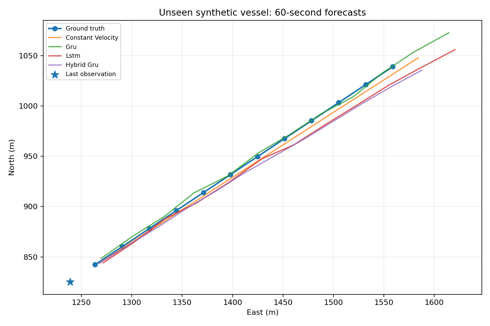
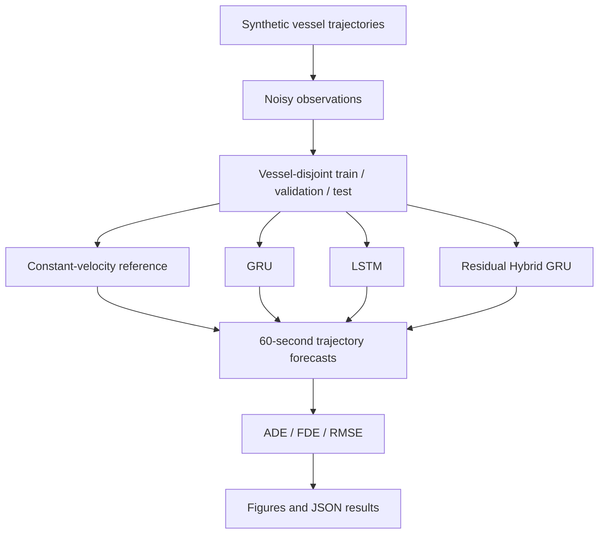
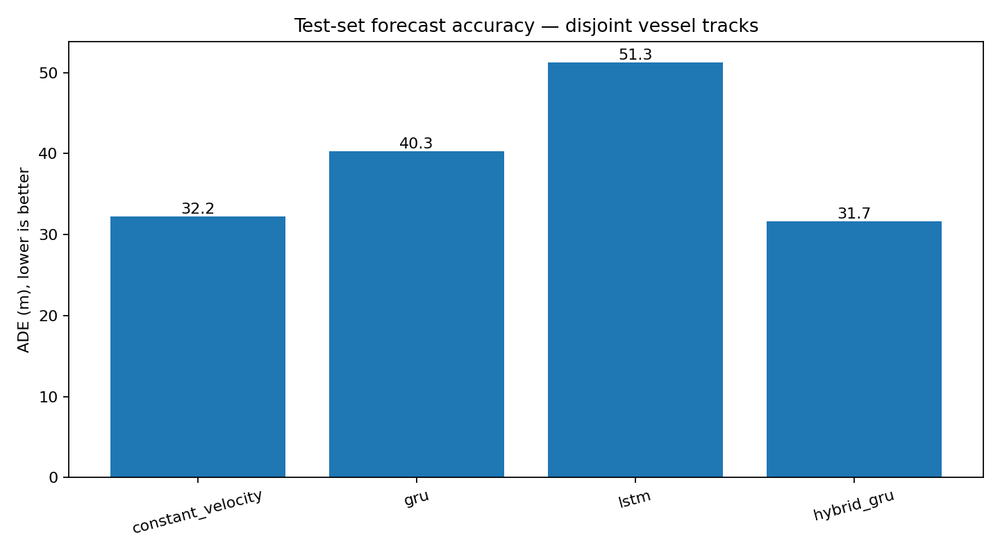
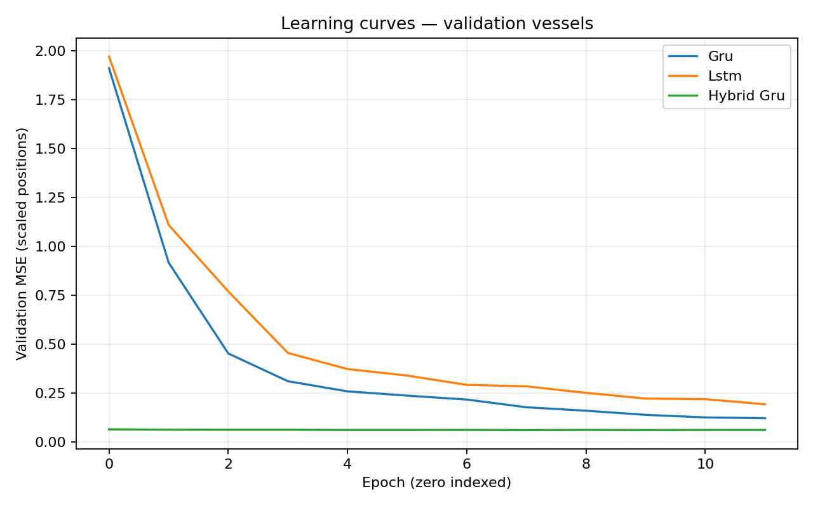
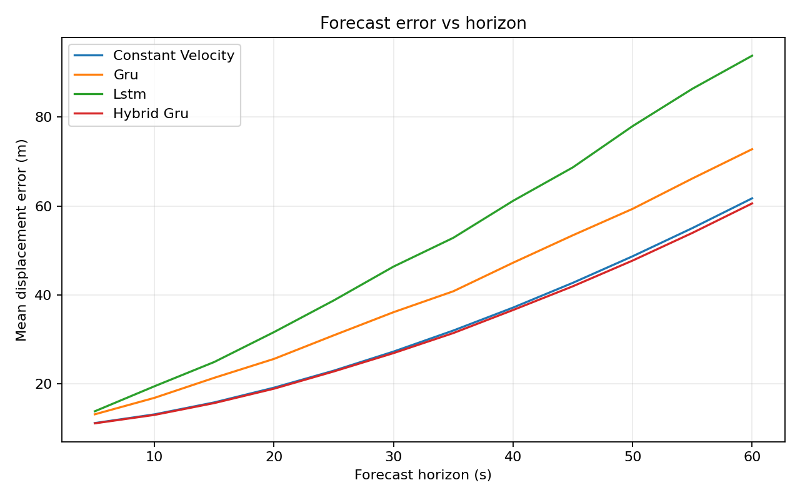

<div align="center">

# 🌊 Maritime AI — Hybrid Vessel Trajectory Forecasting

### Physics Baseline · GRU · LSTM · Hybrid GRU · Synthetic Maritime Intelligence

**A reproducible research benchmark for short-horizon vessel motion prediction using trained recurrent neural networks and a physics-informed residual forecaster.**



*An unseen synthetic vessel trajectory: ground truth and 60-second forecasts.*

</div>

> **Research status:** This repository contains actually trained GRU and LSTM models, a residual hybrid GRU, and a constant-velocity reference model. All data are **synthetic**, generated in a local East–North coordinate frame. This is not a real-AIS benchmark, operational navigation system, or maritime safety application.

## Highlights

- **Reproducible synthetic vessels:** variable speed, straight motion, gradual turns and oscillatory maneuvers.
- **Vessel-disjoint data splits:** 65 training vessels, 15 validation vessels and 20 unseen test vessels. Each vessel produces multiple overlapping windows, but vessel identities never cross splits.
- **Four forecasting methods:** constant-velocity baseline, GRU, LSTM and a physics-informed residual GRU.
- **60-second prediction horizon:** 12 future steps at five seconds each.
- **Metrics:** average displacement error (ADE), final displacement error (FDE) and two-dimensional RMSE.
- **Artifacts:** saved PyTorch weights, JSON metrics and four publication-style figures.
- **Tests:** four passing automated checks.

## Architecture



## Mathematical approach

### 1. Constant-velocity reference

Given a history of noisy East–North positions, the reference velocity is estimated using the first and last observation of the history window:

$$
\hat{\mathbf{v}}_k = \frac{\mathbf{z}_k-\mathbf{z}_{k-L+1}}{(L-1)\Delta t}, \qquad L=12,\ \Delta t=5\ \mathrm{s}.
$$

The future displacement for horizon step $h$ is

$$
\Delta\hat{\mathbf{p}}_{k+h\mid k}=h\Delta t\hat{\mathbf{v}}_k, \quad h=1,\ldots,12.
$$

This is a **constant-velocity baseline**, not a Kalman filter. A Kalman tracking filter is available in the earlier version of the repository and is a potential integration step.

### 2. GRU and LSTM

Both neural networks encode a 12-observation history using 32 recurrent hidden units and a small feedforward forecasting head. They output 12 two-dimensional future displacements relative to the most recent noisy observation. Models are optimized using mean-squared displacement error with Adam.

### 3. Physics-informed hybrid GRU

The hybrid network predicts a **residual correction** to the constant-velocity forecast:

$$
\Delta\hat{\mathbf{p}}^{\mathrm{hybrid}}_{k+h\mid k} =
\Delta\hat{\mathbf{p}}^{\mathrm{CV}}_{k+h\mid k}
+ f_{\theta}(\mathbf{z}_{k-L+1:k})_h.
$$

This formulation lets the network learn deviations from the physical baseline rather than predicting all motion from scratch. It is not a formal physics-constrained optimization model; the physics prior enters through the additive baseline.

### 4. Evaluation

For predicted position $\hat{\mathbf{p}}_{k+h\mid k}$ and ground truth $\mathbf{p}_{k+h}$, displacement error is

$$
 d_{k,h}=\left\|\hat{\mathbf{p}}_{k+h\mid k}-\mathbf{p}_{k+h}\right\|_2.
$$

**ADE** averages the displacement error over all test windows and all 12 forecast steps; **FDE** averages the error at the 60-second endpoint. Lower values are better.

## Experimental configuration

| Parameter | Value |
|---|---:|
| Random seed | `42` |
| Training / validation / test vessels | `65 / 15 / 20` |
| Vessel samples | `105` per vessel |
| Observation interval | `5 seconds` |
| History | `12 observations` |
| Prediction horizon | `12 steps = 60 seconds` |
| Position observation noise | `8 m` standard deviation per axis |
| Recurrent hidden size | `32` |
| Maximum epochs | `12` |
| Optimization | Adam, learning rate `0.002` |
| Loss | Mean squared error |
| Early stopping | 5 epochs without validation improvement |

The train, validation and test sets use different trajectory seeds. This avoids overlapping windows from the **same vessel** leaking across splits, but the synthetic simulator is shared across all splits.

## Experimental results

The following values were **measured by executing the code** with the configuration above. They are not estimates or illustrative numbers.

| Model | ADE (m) ↓ | FDE (m) ↓ | 2D RMSE (m) ↓ |
|---|---:|---:|---:|
| Constant velocity | 32.20 | 61.72 | 42.28 |
| GRU | 40.29 | 72.79 | 50.54 |
| LSTM | 51.30 | 93.84 | 65.62 |
| **Hybrid GRU** | **31.68** | **60.58** | **41.33** |

In this single seeded experiment, **Hybrid GRU achieved the lowest test error**. The ADE reduction relative to constant velocity was approximately **1.6%**. GRU and LSTM did not outperform the physics baseline. This is an important experimental result: a learned model is **not automatically superior** to a simple physical predictor. Results should not be generalized without repeated-seed evaluation and independent real-world data.

### Figure 1 — Example forecast on an unseen vessel


### Figure 2 — Model comparison on test vessels



### Figure 3 — Neural model learning curves



### Figure 4 — Prediction error across the forecast horizon



## Reproduce the experiment

Requires Python 3.10 or newer. PyTorch CPU is sufficient for this small benchmark.

```bash
git clone https://github.com/Mates3834/Maritime-AI-Trajectory-Prediction.git
cd Maritime-AI-Trajectory-Prediction
python -m venv .venv
```

Activate the environment:

```bash
# macOS / Linux
source .venv/bin/activate

# Windows PowerShell (instead of the command above)
# .venv\Scripts\Activate.ps1
```

Install dependencies and run:

```bash
python -m pip install -e .
python -m pip install pytest
python -m maritime_hybrid.experiment --epochs 12 --seed 42
python -m pytest -q
```

To change the training vessel count or output directory:

```bash
python -m maritime_hybrid.experiment --train-vessels 100 --epochs 20 --output results_extended
```

The run saves `gru.pt`, `lstm.pt`, `hybrid_gru.pt`, `metrics.json` and four figures under the selected results directory.

## Repository structure

```text
Maritime-AI-Trajectory-Prediction/
├── README.md
├── pyproject.toml
├── requirements.txt
├── LICENSE
├── src/maritime_hybrid/
│   ├── __init__.py
│   ├── data.py
│   ├── models.py
│   └── experiment.py
├── tests/
│   └── test_pipeline.py
└── results/
    ├── metrics.json
    ├── gru.pt
    ├── lstm.pt
    ├── hybrid_gru.pt
    ├── 01_forecast_comparison.png
    ├── 02_ade_benchmark.png
    ├── 03_learning_curves.png
    └── 04_horizon_error.png
```

## Limitations and next research steps

- **Synthetic-only evaluation.** No real AIS ingestion or vessel-identity information is used.
- **Single simulator distribution.** The test vessels are disjoint, but follow the same simulator family as training vessels.
- **Single-seed experiment.** Run multiple independent seeds and report mean, standard deviation and confidence intervals.
- **No uncertainty calibration.** Forecasts are point estimates without probabilistic confidence regions.
- **No maneuver-specific test suite.** Break out results for straight, turning, acceleration and out-of-distribution trajectories.
- **No anomaly classifier in this version.** Sensor outlier screening from the earlier Kalman prototype is not part of this neural benchmark; integrating it is future work.
- **No multi-vessel interactions.** Encounter behavior and collision risk are outside the present scope.

### Roadmap

- [x] Synthetic trajectory generation
- [x] Vessel-disjoint train / validation / test split
- [x] Train GRU and LSTM models
- [x] Physics-informed residual GRU
- [x] Compare ADE / FDE / RMSE
- [x] Save reproducible metrics, model weights and plots
- [ ] Multi-seed statistical study
- [ ] Kalman-filter preprocessing and IMM/EKF baselines
- [ ] Labeled sensor and maneuver anomalies with precision / recall / F1
- [ ] Probabilistic forecasts and calibrated uncertainty
- [ ] Real AIS validation with appropriate data licensing

## License

MIT — see [LICENSE](LICENSE).

---

<div align="center"><sub>Research prototype · Synthetic maritime data · Trained neural forecasting baselines · Not for operational navigation</sub></div>
